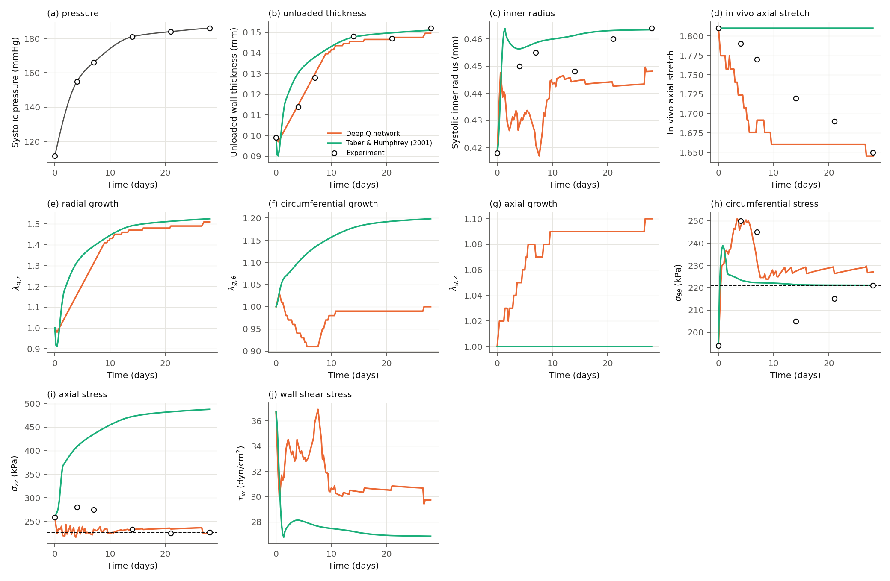

# RL growth laws for arteries, re-implemented in PyTorch

A re-implementation of

> M. Liu, L. Liang, H. Dong, W. Sun, R. L. Gleason, *Constructing growth evolution laws of arteries via
> reinforcement learning*, J. Mech. Phys. Solids (2022).

Everything lives in one notebook, [`rl_growth_dqn.ipynb`](rl_growth_dqn.ipynb), which covers the deep
Q network (DQN) part of the paper:

```
rl_growth_dqn.ipynb
  1  units                    mmHg -> kPa, Poiseuille wall shear stress (Eq. 4)
  2  mechanics                four-fiber model + remodelling (Eqs. 19-20), thin-walled IAA (Eqs. 21-22),
                              Gasser-Ogden-Holzapfel model (Eq. 23), bi-layer thick wall (Eqs. 24-27),
                              unloading and opening angles
  3  experimental data        approximate values digitised from Figs. 6 and 8 (Bersi et al. 2017)
  4  growth MDPs              Example-1 env (27 actions), Example-2 env per layer (9 actions), reward Eq. 13
  5  expert growth laws       Taber & Humphrey 2001 (Eq. 7), Liu et al. 2019 (Eqs. 8-9)
  6  double DQN               soft target update (Eq. 17), batched environments, greedy policy (Eq. 18)
  7  figures                  mirroring Figs. 6-8 and 11-14
  8  Example 1                hypertensive growth of the murine infrarenal abdominal aorta
  9  Example 2                growth-induced residual stress in the bi-layer human ascending aorta
  10 sanity checks            numbers quoted in the paper (Tables 2 and 5, day-0 state)
results/example1/, results/example2/
                              trained networks (dqn_agent*.pt), training histories (dqn_training*.npz),
                              reference rollouts (sim_*.npz), summary.json and the figures (*.png)
```

The notebook is committed with its outputs, so the figures and tables render directly on GitHub.

## Results at a glance

The figure below is the Example 1 output (hypertensive growth of the murine infrarenal abdominal
aorta over 28 days) from Section 8 of the notebook, with the DQN trained for the paper's 30 000 episodes.



The panels correspond to three figures of the paper, so they can be compared directly with the
[version of record](https://www.sciencedirect.com/science/article/pii/S002250962200223X):

| Panels here | Paper |
|---|---|
| (a) pressure, (b) unloaded thickness, (c) inner radius, (d) in vivo axial stretch | Fig. 6 (a)-(d) |
| (e) radial, (f) circumferential, (g) axial growth stretch | Fig. 7 (a)-(c) |
| (h) circumferential stress, (i) axial stress, (j) wall shear stress | Fig. 8 (a)-(c) |

Two things differ from the paper's plots. The paper also draws the constrained-mixture curve of
Latorre et al. (2019), which is not re-implemented here, and its Fig. 6 shows experimental error
bars where this figure shows only the digitised mean points.

## Running

Developed with Python 3.12. Install the dependencies into whatever environment you like:

```bash
pip install -r requirements.txt
jupyter notebook rl_growth_dqn.ipynb
```

or run it headless from the repository root:

```bash
jupyter nbconvert --to notebook --execute --inplace rl_growth_dqn.ipynb
```

**Training is off by default.** The flag `RETRAIN = False` at the top of the notebook skips the training
cells and loads the trained networks from `results/example1/dqn_agent.pt` and
`results/example2/dqn_agent_{media,adventitia}.pt`. The notebook then rolls the learned policies out
through the mechanics, runs the expert laws for comparison, checks the rollouts against the stored
reference results, and rewrites the figures and `summary.json` in `results/`. With training off the whole
notebook runs in well under a minute.

Setting `RETRAIN = True` trains from scratch with exactly the settings that produced the checkpoints
(30 000 episodes for Example 1, about 27 min on a laptop CPU; 3 600 episodes per layer for Example 2,
about 8 min each) and overwrites the checkpoints and training histories.

## What is implemented (mapping to the paper)

| Paper | Notebook |
|---|---|
| Kinematics F = Fe Fg, explicit Euler update of Fg (Sec. 2.1) | `simulate_iaa`, `simulate_aorta` |
| Thin-wall IAA equilibrium, Eqs. 21-22, material remodelling Eq. 20 | `ThinWallArtery.solve` |
| Bi-layer thick wall, Eqs. 24-27, Table 4 Gauss points | `BilayerAorta.evaluate / loaded` |
| Unloading (p = 0, zero axial force) and opening angles (+ zero moment) | `BilayerAorta.unloaded / opening_angle` |
| State s = [s_tt, s_zz, tau_w], 3 actions per direction with g = 0.01, reward beta1 ln d + beta2 (beta1 = -40, beta2 = 150, clipped to +-80), gamma = 0.99 | `IAAGrowthEnv`, `BilayerGrowthEnv` |
| Termination: 500 steps or |ds_tt|, |ds_zz| >= 200 kPa, |dtau_w| >= 20 dyn/cm^2 | `GrowthEnvBase.is_terminal` |
| Double DQN, 2 hidden ReLU layers, Adam, experience replay, epsilon-greedy, target smoothing eta = 1e-4 | `DQNAgent`, `train_dqn` |
| Greedy deployment of the trained network, Eq. 18 | `QNetworkPolicy` |
| Example 2 weights: tau_w weight 100 (media) / 33.3 (adventitia); training on Loc 3, deployment on all 5 points of both layers | `BilayerGrowthEnv`, `simulate_aorta` |
| Expert laws Eq. 7 with (T_r, T_t, T_tau) = (0.3, 3, 5) days, Eq. 8 with alpha = (1e-3, 1e-3, 0, 1e-3), T = 1 day | `TaberHumphreyLaw`, `Liu2019Law` |

The paper's tabular dynamic-programming policies are not part of this notebook.

## Implementation choices and deviations

The mechanics are vectorised, so the DQN steps 64 independent episodes at once (`n_envs=64`) and does
4 gradient updates per batched step (`updates_per_step=4`). This only changes throughput; the algorithm
is still the standard double DQN. The paper's 30 000 episodes take roughly half an hour on a laptop CPU
instead of 40 h.

Episodes start from a random state of the discrete growth grid, restricted to states inside the
termination thresholds. Most of the 68 921 IAA states lie far outside them and would end the episode
after a single step.

Near homeostasis the clipped reward makes several actions equally good, so the deployed policy needs a
tie-breaking rule. Its greedy policy picks "no growth" whenever that action's Q value is within
`QUIESCENCE_TOL` (default 3e-3, relative) of the best one. Example 1 is insensitive to this setting. In
Example 2 the plain argmax lets the ten distributed agents drift collectively (loaded r_i goes from 7.99
to 7.40 mm after 4 days), while the default keeps the diameter unchanged.

The paper does not give the network size or learning rate. I use 64-64 hidden units, lr 1e-3,
batch 64, a replay buffer of 1e6, and epsilon decaying from 1 to 0.01 over the first 30 % of planned
steps. Rewards are scaled by 1/80 inside the agent, which does not change the optimal policy.

For the Liu et al. (2019) law, the RL paper does not specify the exponent beta or the pause
threshold h0; beta = 1 and h0 = 0.5 are used (`Liu2019Law(h0=0.5)`). The constrained-mixture model of
Latorre et al. (2019) shown in Fig. 6 is not re-implemented.

The experimental data (pressure schedule, thickness, radius, axial stretch, stresses) are read off
Figs. 6 and 8 and are approximate. Where the text gives exact values (day-0 geometry, homeostatic
stresses, day-0 pressure), those are used instead.

The opening angle follows Fung's definition: the angle between the two lines joining the mid-point
of the inner arc to its tips, so a closed ring has 0 deg. The sector angle is found by driving the
bending moment to zero with a bracketing scalar solve, with (rho_i, Lambda) obtained from radial and
axial equilibrium at each trial angle. For the grown states of Example 2 the cut sector is almost
stress free for *every* angle (|sigma| < 1.5 kPa), so the opening angle is very sensitive to small
differences in the growth field. See the results section.

Wall shear stress uses Q = 2.8 ml/min and mu = 4.5 cP for the IAA, and Q = 856.5 ml/min for the
human aorta. These reproduce the paper's tau_w,h = 26.8 and 1.6035 dyn/cm^2.

## Verification against the paper

* `BilayerAorta` with Fg = I gives r_i = 7.99 mm and layer-mean stresses (160.5, 102.0) kPa in the
  media and (56.1, 36.7) kPa in the adventitia (paper: 160.10, 101.87, 55.96, 36.70; Table 5).
* `ThinWallArtery` at day 0 gives r_i = 0.418 mm, s_tt = 194 kPa, s_zz = 260 kPa,
  tau_w = 36.7 dyn/cm^2, matching the day-0 points of Figs. 6 and 8.
* Taber & Humphrey law, Example 1: lam_g(28 d) = (1.53, 1.20, 1.00) with runaway s_zz
  (paper: lam_g,t = 1.20, s_zz off-scale in Fig. 8b). Example 2: lam_g,r at Loc 1 / Loc 5 of the
  media = 1.29 / 0.68 and lam_g,t = 1.03 / 0.97, identical to Figs. 13-14.
* Example 1 at day 28 (`results/example1`, DQN trained for the paper's 30 000 episodes; see the figure
  above):

  | law | lam_g (r, t, z) | H unloaded (mm) | r_i (mm) | in vivo lam_z | (s_tt, s_zz, tau_w) |
  |---|---|---|---|---|---|
  | Deep Q network | (1.51, 1.00, 1.10) | 0.149 | 0.448 | 1.645 | (227, 224, 29.7) |
  | Taber & Humphrey | (1.53, 1.20, 1.00) | 0.151 | 0.463 | 1.81 | (221, 488, 26.9) |
  | paper (DQN) | lam_g,t = 1.04, lam_g,z = 1.10 | ~0.15 | ~0.46 | ~1.65 | restored |
  | experiment | - | 0.152 | 0.464 | 1.65 | (221, 226, 26.8) |

  The learned law reproduces the reduction of the in vivo axial stretch, the wall thickening and the
  transient peaks of r_i and tau_w seen in Figs. 6-8.
* Example 2 (`results/example2`, 3 600 DQN episodes per layer):

  | law | opening angle media / adventitia (deg) | loaded r_i (mm) | layer-mean s_tt media / adv (kPa) |
  |---|---|---|---|
  | Deep Q network | 87.3 / 37.4 | 7.985 | 161.1 / 55.6 |
  | Taber & Humphrey | 88.9 / 76.5 | 7.990 | 160.5 / 56.1 |
  | Liu et al. (2019) | 55.6 / 36.7 | 8.878 | 97.1 / 73.4 |
  | paper (DQN / T&H / Liu) | 123.0 / 71.4, 125.3 / 71.2, 40.3 / 38.6 | ~7.99 (RL, T&H), larger (Liu) | - |

  The qualitative picture of Figs. 11-14 and Table 6 is reproduced. The RL and Taber-Humphrey laws
  homogenise the stresses at homeostatic levels without changing the diameter. RL does so through
  circumferential growth only, adding volume at Loc 1 and removing it at Loc 5, whereas the
  Taber-Humphrey law thickens the inner wall and thins the outer one. The Liu law enlarges the
  vessel and gives compressive media / tensile adventitia residual stresses and the smallest opening
  angles. The absolute opening angles differ from Table 6 even though the Taber-Humphrey growth
  field is reproduced to three digits. As noted above, the cut sector is nearly stress free for
  every sector angle, so this number depends strongly on the integration and interpolation details.
